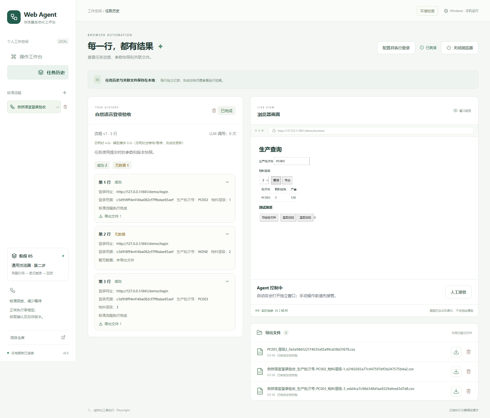

# 自然语言登录验收

2026-10-22，Windows 当前用户环境，全部使用本地合成站点、临时 SQLite 数据库及确定性模型替身；不使用真实账号或已安装应用数据。

真实 UI 验收覆盖：打开合成登录页，分别自然语言录入短账号 `a` 和包含双引号、反斜杠及中文的密码，点击登录，显示“结果待确认”，选择唯一可见的业务标识并明确确认，再录制查询与导出、保存标准流程。测试关闭原应用的完整生命周期和浏览器，使用同一临时库创建全新应用，模型 URL/名称留空，然后从 UI 粘贴三行参数并运行。

离线结果：`PC002/1` 成功、`NONE/2` 无数据、`PC003/3` 成功；模型调用为 0，两次成功分别获得唯一且可下载的 CSV，无数据行不导出。密码原值未出现在实际模型请求或数据库明文中；一字母账号以数据流/字段断言验证，避免把固定英文协议及随机引用中的字母当成泄露。



相关专项测试覆盖未保存反馈、人工接管互斥、隐藏字段排除、登录标识可见且唯一、其他账号会话复用、无法确认的导出不重复、嵌套 JSON 文本中的凭据拒绝，以及当前 Windows 用户 DPAPI 的持久化和重新读取。

集成中修复了两类实际问题：全局子串替换会损坏短凭据对应的工具名、模式、输入类型与生成的文件引用；独立登录点击后的异步导航会使立即观察命中已销毁的浏览器上下文。现在先清理数据字段再序列化，保留受控协议与类型元数据；已识别的登录提交只点击一次，在来源保护下有限等待导航，无导航 SPA 超时后仍须人工确认成功标识。

持久化扫描按语义数据叶节点检查，固定认证字段身份定位（如 `#password`）可与协议字面量同名；任意定位中的真实凭据值、URL 段以及嵌套 JSON 数据仍拒绝保存。短字母数字凭据按独立 token 检查，长凭据保留子串/转义变体检查。没有禁止短凭据，也没有进行一字母全库字节扫描。

验证结果：前端 TypeScript/Vite build 此前通过（1596 modules）。2026-10-23，在补齐 `口令` 同义词识别、密码分类与歧义检测及其 API 隐私回归后，以当前正常 Windows 用户令牌运行完整后端测试，**285 passed in 335.20s**（临时库、合成 DPAPI 数据、确定性模型替身；basetemp 为 `.superpowers/pytest-final-synonym-resume-20261023`）。该结果覆盖本次最终产品与测试树。此前完整测试 265 项及修正后受影响测试 76 项均通过，作为历史记录保留。`git diff --check` 通过。

复现命令（仓库根目录，使用临时数据；Windows DPAPI 测试需当前正常用户令牌）：

```powershell
$env:PYTHONPATH=(Join-Path (Get-Location) 'backend')
$env:PYTHONUTF8='1'
.venv/Scripts/python.exe -m pytest backend/tests -q -p no:cacheprovider --basetemp=.superpowers/t6-full
.venv/Scripts/python.exe -m pytest backend/tests/test_contextual_secrets.py backend/tests/test_agent.py backend/tests/test_credential_actions.py backend/tests/test_login_recording.py backend/tests/test_natural_login_ui.py backend/tests/test_recovery_agent.py backend/tests/test_parameter_suggestions.py backend/tests/test_tasks_api.py backend/tests/test_workflow_repository.py backend/tests/test_downloads.py -q -p no:cacheprovider --basetemp=.superpowers/t6-post-review
npm.cmd --prefix frontend run build
```

每次复现应选择新的 basetemp 名称。真实 UI 测试除了断言模型调用和下载内容，还按持久化 JSON 的数据叶值检查短账号原值未保存，并验证带特殊字符密码未出现在模型请求/库明文。

限制：模型替身验证真实工具协议与浏览器执行链，不代表真实模型提供商兼容性或真实内网站点验收。不涵盖验证码、跨站 SSO、多标签页、分段登录或人工键盘自动录制。未在本步骤部署安装目录、发布 PR 或修改用户 `.env`；部署与发布由后续独立门禁执行。
